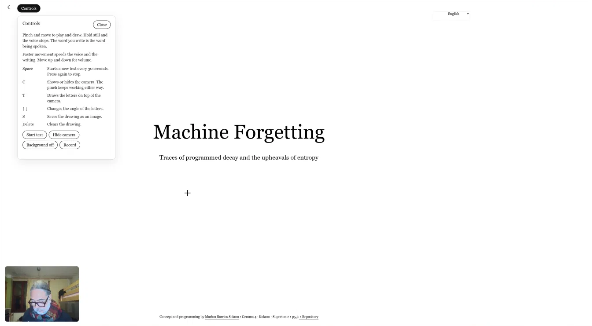
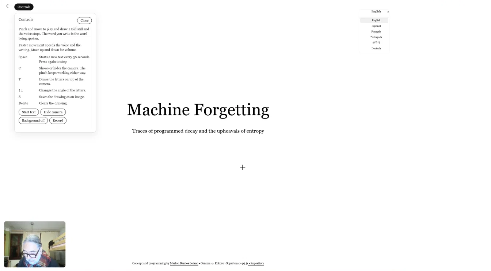

# Machine Forgetting

A hand, a camera, and a local language model. The pinch of thumb and index is how the mind of the piece becomes visible: it plays the voice and lays letters down as traces. The letters fade. The voice lasts only while the pinch is moving. Hold still and it goes silent. The text is written as a mind that leaves traces and makes gestures in order to be recognized, then lets them go.

Text comes from Gemma 4 through Ollama on this computer. English is spoken by Kokoro. Spanish, French, Portuguese, Korean, and German are spoken by Supertonic. Nothing is sent to an external GPT.

## The page



The controls stay at the top left. The color camera thumbnail sits at the bottom left.



## What you do

Instructions sit at the top left of the page.

| Action | Result |
|--------|--------|
| **Space** | Start a new text every 30 seconds. Press Space again to stop the cycle. |
| **Pinch and move** (thumb and index) | Play the voice and draw the letters. Hold still and the voice stops. The word being written is the word being spoken. |
| **Move up and down** while pinching | Volume. |
| **Move faster** | The voice and the writing speed up together. |
| **C** | Show or hide the color camera thumbnail at the bottom left. Tracking continues either way. The thumbnail is visible when the page opens. |
| **T** | Show the camera full screen in black and white, and draw on top of it. Press T again to return to the plain ground. |
| **Record** | Save a video of the drawing and the voice as a `.webm` file. Press the button again to stop and download. |
| **Backspace / Delete** | Clear the drawing. |
| **S** | Save the canvas as a PNG. |
| **Arrow up / down** | Angle of the letters. |

The screen counts the texts: **Generation 1**, **Generation 2**, and so on. While the next one is being written, the pinch, the voice, and the traces already on screen keep going. The new text replaces the old one only when both the words and the sound are ready.

## Run it

Ollama must already be running, with `gemma4:latest` installed. No API key is required. Node 22 or newer.

PowerShell on this machine blocks `npm.ps1`. Use one of these instead of `npm run dev`:

```bat
node server.js
```

```bat
dev.cmd
```

```bat
npm.cmd run dev
```

Then open **http://localhost:5180** in desktop Chrome. Allow the camera when Chrome asks. Do not use port 5173: on this computer that address is another project, My LatentWelt.

The first launch loads Kokoro and Supertonic. Later runs reuse the weights already on disk. Supertonic runs in its own process so it does not clash with Kokoro.

If 5180 is already taken, the server tries the next port and prints the URL to use.

### Chrome window

```bat
node chrome-app.js
```

or double-click `app.cmd`. That starts the same server and opens the piece in a Chrome window. Keep a single window of the project open, so the camera is not shared with a second tab.

Optional `.env` overrides:

```bash
OLLAMA_HOST=http://127.0.0.1:11434
OLLAMA_MODEL=gemma4:latest
KOKORO_VOICE=af_heart
SUPERTONIC_VOICE=F1
SUPERTONIC_STEPS=8
PORT=5180
```

## Models

| Use | Engine | Notes |
|-----|--------|--------|
| Text, `/api/chat` | Ollama `POST /api/chat`, model `gemma4:latest`, `think: false` | Writes in the language selected in the menu |
| Speech, `/api/audio` | Kokoro JS (`af_heart`) | English |
| Speech, `/api/audio` | Supertonic 3, voice `F1` | Spanish, French, Portuguese, Korean, German |
| Hands | MediaPipe Hand Landmarker | Color webcam. Pinch is thumb tip to index tip. |

The language menu is those six languages. English is the default.

## Project layout

| Path | Role |
|------|------|
| `index.html`, `sketch.js` | The p5.js piece: text, drawing, voice, instructions, recording |
| `handTracker.js` | Camera and pinch detection |
| `api/chat.js` | Local Gemma chat |
| `api/audio.js` | Kokoro or Supertonic, returned as WAV |
| `server.js` | Express plus Vite, default port 5180 |
| `chrome-app.js`, `app.cmd` | Chrome window for the piece |
| `lib/kokoro.js` | Kokoro loader. Requests are queued so two voices are not made at once |
| `lib/supertonic/` | Supertonic 3, isolated in a worker process |
| `models/supertonic-3/` | Supertonic weights, not committed |

## If something fails

- **`npm.ps1 cannot be loaded`**: run `node server.js` or `npm.cmd run dev`. Do not change the PowerShell execution policy.
- **Ollama is not running**: start the Ollama app, then press Space again.
- **The page is the wrong project**: you are on port 5173. Use **http://localhost:5180**.
- **Camera denied or in use**: close the other window that holds the webcam, then reload this one. Pinch needs the camera. The thumbnail can be hidden with C without stopping tracking.
- **MediaPipe logs** (OpenGL, TensorFlow Lite): normal hand-tracking noise.
